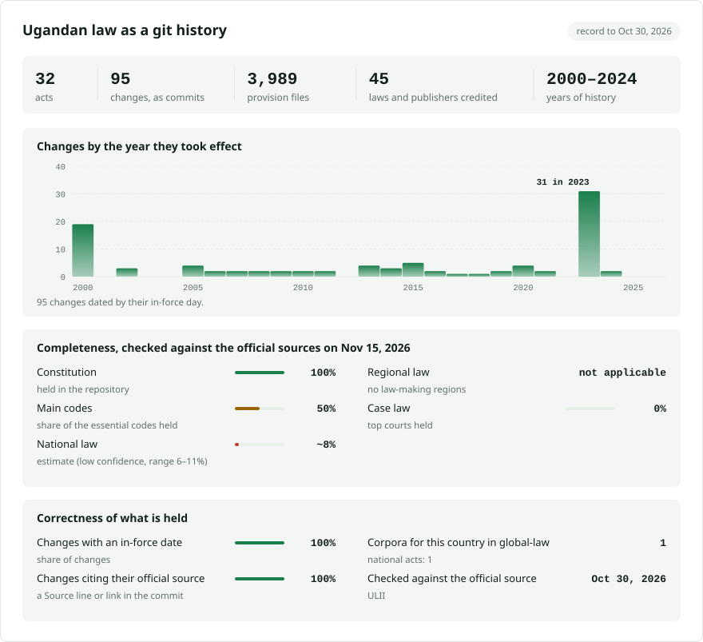

# Uganda: law history in git

<picture>
<source media="(prefers-color-scheme: dark)" srcset="data/effort-dark.svg">

</picture>

The law of Uganda as a git history: one file per section or article, one commit per version on the day it took effect, and the law that made each change as the commit's author. `git blame` names the law behind every paragraph; `git log` lists every change to a provision; picking a date gives the text in force that day.

Part of [lexifina/global-law](https://github.com/lexifina/global-law), one git history for every country's law: this is Uganda's national law, which global-law reads at `uganda/national/acts/`.

**What is in it now:** the Constitution and 31 other Acts from ULII (the Penal Code, the Evidence Act, the Companies Act, the Succession Act and others), with 99 dated versions from 2000 to 2024; 5 Acts of Parliament as enacted and 14 chapters of the Revised Edition 2000, from Parliament of Uganda. [`REPRODUCE.md`](REPRODUCE.md) lists the ULII acts and their versions; [`STRUCTURE.md`](STRUCTURE.md) gives the layout.

Each act is a folder, `acts/<year>/<NNN>-<slug>/` by the law that made it or `laws/cap-NNN-<slug>/` by its chapter in the Revised Edition 2000 (see [`STRUCTURE.md`](STRUCTURE.md)), with one file per section, article or schedule (articles too are named `sec-<number>.md`), plus `long-title.md` and a `README.md` listing its provisions and their changes (`constitution/sec-102.md` is Article 102 of the Constitution, on who may be elected President).

The text is in English, as ULII and Parliament publish it; its editorial notes (kept only where a provision has no other text) and the Part and Chapter headings are left out.

## Questions as git commands

| Question | Command |
| --- | --- |
| Every change to Article 102 of the Constitution | `git log -p --word-diff -- constitution/sec-102.md` |
| Which law wrote each line of Article 102? | `git blame constitution/sec-102.md` |
| Every version of the Constitution, with the day each took effect | `git log --format="%h %(trailers:key=In-force,valueonly,separator=) %an" -- constitution ':!constitution/README.md'` |
| Article 102 as in force on 1 January 2015 | `python tools/on.py 2015-01-01 constitution sec-102` |

**Outside git**, we also host this record publicly, for free:

- **[Ask Claude about Ugandan law](https://global-law.lexifina.com/v1/try_claude?country=uganda)**: opens Claude with a first question ready.
- **[Ask ChatGPT](https://global-law.lexifina.com/v1/try_chatgpt?country=uganda)**: the same question in ChatGPT.
- **[Search Ugandan law on our site](https://lexifina.com/law?country=uganda&q=bail)**: a search for "bail", with each provision's text and its versions, no account needed.
- **[Developer REST API](https://global-law.lexifina.com/v1/search_law?query=bail&jurisdiction=uganda)**: the same search as JSON, with no key. See the [documentation here](https://lexifina.com/api/global-law).

Both assistants read the record through the free Global law connector (MCP, `https://global-law.lexifina.com/mcp`); the first time, the chat gives you the link that adds it. Ask in English.

**Host it yourself easily.** All it takes is git and Python, and the tools run on your machine:

```sh
git clone --depth 1 https://github.com/lexifina/global-law && cd global-law
python3 tools/countries.py add uganda/national/acts
python3 tools/law.py show 2026-01-01 uganda/national/acts/constitution/sec-102.md
```

Opened in Claude Code, Cursor, VS Code or Codex, the clone also starts a local MCP server with the same tools ([MCP.md](https://github.com/lexifina/global-law/blob/main/MCP.md)).

## Dates

Each commit is dated at noon, Africa/Kampala, on the day the version took effect, and carries it in its `In-force:` trailer. The day is ULII's, the date of its point-in-time version (expression):

- for an amendment, the day it came into force, as ULII's amendment list gives it ("[Amended by <Act> on <date>]");
- for a revised edition, the day the edition is as at: 31 December 2000 (the Revised Edition of the Laws of Uganda) for the first version of 19 acts, and 31 December 2023 (the Revised Laws 2023) for 29 versions;
- for an act as enacted, its Gazette publication, or the commencement day ULII states where it gives one (the Companies Act 2012, published on 18 September 2012, is dated 1 July 2013).

Each change is credited to the law ULII's History names (`Act 1 of 2018`, `Statutory Instrument 25 of 2014`), and a provision only to a law its editorial note names where one version takes in several or is a revised edition; the rest are committed by the publisher (`ULII`) and labelled unexplained. The first version of 12 acts is the act as enacted, credited to the act itself; for the other 20 it is the "oldest version available", credited to ULII.

## How it is checked

- `tools/check_repo.py` reads every version back from git on the day it took effect and on the day before, and compares it with the corpus: 99 versions of 32 acts, 0 mismatches (see [`REPRODUCE.md`](REPRODUCE.md)).
- Every version is parsed from an archived copy of its own dated expression page, whose sha256 is recorded with it; every version ULII's History lists for an act is here.
- A second build from the same corpus gave identical hashes for all 95 history commits and 143 tags.
- History is append-only: no merge commits and no commit date that goes backwards.
- [vulnerabilities/](vulnerabilities/): possible drafting mistakes in this law, found by global-law's detectors and checked by hand. Not run yet.

## What it does not show

- **Most Ugandan law.** Only these 32 acts: no subsidiary legislation and no case law. Acts with a listed version that could not be read are left out, among them the Children Act, the Parliamentary Elections Act 2005 and the Data Protection and Privacy Act 2019.
- **Changes before ULII's oldest version.** 19 acts start at the 2000 Revised Edition, which already holds the earlier amendments; the Political Parties and Organisations Act starts at the Revised Laws 2023.
- **Which Act made the Revised Laws 2023's changes.** ULII publishes the edition as a consolidation, so wording it changed is credited to `ULII` unless a note names an Act; each such commit message names the Acts the version also takes in (for the Penal Code, the Law Revision Acts of 2021 and 2023).
- **One provision across the 2023 renumbering.** The Revised Laws 2023 renumbered sections, and files are named by number, so on 31 December 2023 a file can change from one provision to another (`penal-code/sec-166.md`); use `git log -p` around that day.
- **Changes within a line.** Each paragraph is one line, so blame credits a whole paragraph; use `git log -p --word-diff` for the words.

## Sources

| Source | Kind | Past versions | Notes |
| --- | --- | --- | --- |
| [ULII](https://ulii.org) (Judiciary of Uganda, on the Laws.Africa Peachjam platform) | Legal information institute: consolidated acts | yes, each dated point-in-time version | The text, the day each version took effect, the History and amendment lists, and editorial notes naming the amending laws |
| [Internet Archive](https://web.archive.org) | Archived copies of ULII's pages | as archived | Every page was read from an archived copy |

## Licence

See [`LICENSE`](LICENSE). The texts are ULII's, under CC BY-NC 4.0 with ULII credited as the source, so they may be used only for non-commercial purposes; neither ULII nor Laws.Africa endorses this repository. Lexifina's arrangement, commit messages, tables and tools are CC0 1.0.

No AI model wrote, translated or corrected legal text, and none runs at build time; the scripts were written by an AI model (see [`REPRODUCE.md`](REPRODUCE.md)).

## Visualisations

- [visualisations/](visualisations/): charts drawn from this repository. Not drawn yet.

## More

From [lexifina/global-law](https://github.com/lexifina/global-law):

- [FEATURES.md](https://github.com/lexifina/global-law/blob/main/FEATURES.md): every feature, and what every corpus must support (`git blame`, `law.py`, the MCP tools)
- [FAQ.md](https://github.com/lexifina/global-law/blob/main/FAQ.md): questions and answers · [CONTRIBUTING.md](https://github.com/lexifina/global-law/blob/main/CONTRIBUTING.md): proposing changes · [MCP.md](https://github.com/lexifina/global-law/blob/main/MCP.md): the MCP server · [REPRODUCE.md](https://github.com/lexifina/global-law/blob/main/REPRODUCE.md): how it was built · [CHANGELOG.md](https://github.com/lexifina/global-law/blob/main/CHANGELOG.md)
- [FRESHNESS.md](https://github.com/lexifina/global-law/blob/main/FRESHNESS.md): how current each corpus is · [Monitoring](https://github.com/lexifina/global-law/tree/main/monitoring): whether updates are running · [WATCHING.md](https://github.com/lexifina/global-law/blob/main/WATCHING.md): how each official source is watched for changes
- [performance/](https://github.com/lexifina/global-law/tree/main/performance): how fast the tools are, measured
- [visualisations/](https://github.com/lexifina/global-law/tree/main/visualisations): charts and bridges across the world's law
- [Vulnerabilities](https://github.com/lexifina/global-law/tree/main/vulnerabilities): mistakes in legislation as published
